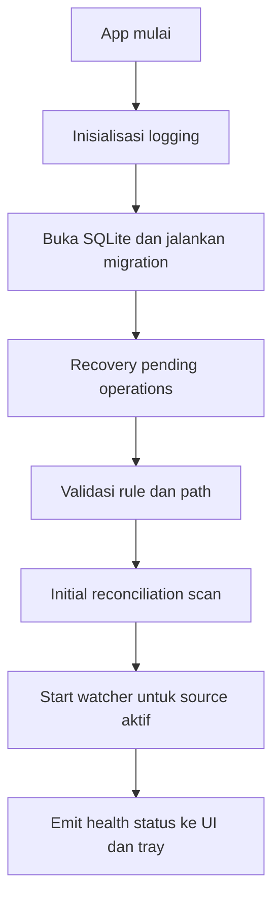
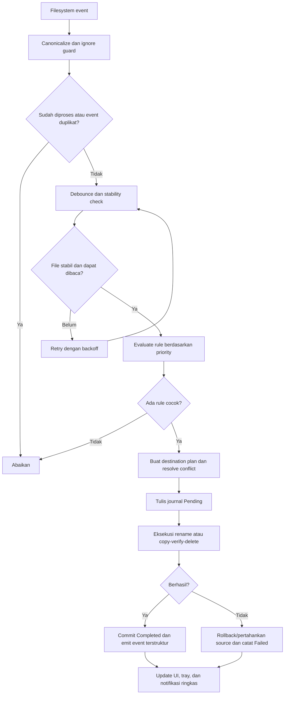
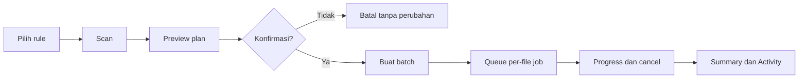
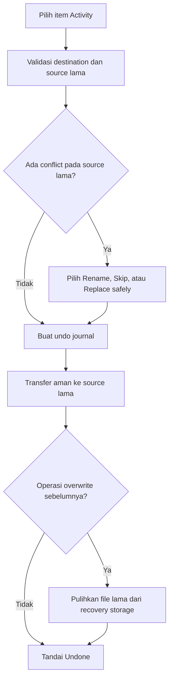
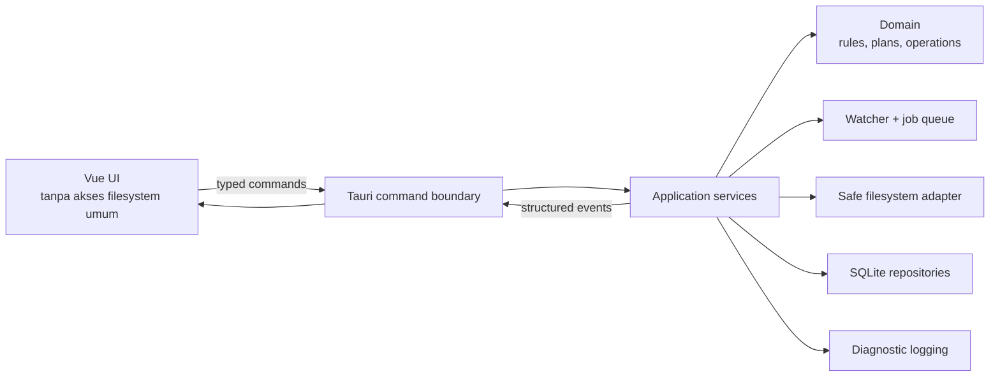

# Product Requirements Document — Auto Manage Files Desktop v2

> Nama pengguna yang dipertahankan: **Auto File Organizer**
>
> Repository: `S-Crocophim/Auto-Manage-Files`
>
> Target platform MVP: Windows 10/11 x64
>
> Mode operasi: 100% lokal/offline, tanpa akun dan tanpa server
>
> Status dokumen: Draft implementasi
>
> Baseline analisis: installer v1.0.1 dan repository `main` pada commit `cbe9e94`
>
> Tanggal: 27 Juli 2026

## 1. Ringkasan keputusan

| Pertanyaan | Keputusan |
|---|---|
| 1. Bahasa dan teknologi | **Rust** untuk engine filesystem dan **TypeScript + Vue 3** untuk UI, dibungkus dengan **Tauri 2** dan dibuild oleh Vite. |
| 2. Struktur | Pisahkan UI, command/IPC, domain, application service, watcher, file operation, database, dan platform Windows. Business logic tidak ditempatkan di komponen Vue. |
| 3. Flow | Event filesystem hanya menjadi pemicu. File masuk ke antrean, ditunggu sampai stabil, dicocokkan ke rule, dibuatkan rencana, dicatat ke journal, baru dipindahkan secara aman. |
| 4. Fitur | Rule CRUD, preview/dry-run, real-time watcher, organize manual, conflict policy, history dan undo, pause/resume, tray, autostart, notifikasi, import/export, tema, dan Bahasa Indonesia/Inggris. |
| 5. UI/UX | Vue 3 Composition API dengan TypeScript, design token berbasis CSS variables, layout desktop empat area: Dashboard, Rules, Activity, Settings. Operasi berisiko selalu diberi preview atau konfirmasi. |
| 6. Offline dan repository | Runtime tidak membutuhkan internet. Data berada di SQLite lokal. Source, CI, dan release berada di repository GitHub yang sudah ada; installer standar dan installer air-gapped dibuat sebagai artefak terpisah. |

**Rekomendasi utama:** jangan kembali ke paket Python/CustomTkinter untuk rebuild ini. Repository saat ini sudah menggunakan fondasi yang lebih tepat, yaitu Tauri 2, Rust, Vue 3, dan Vite. Rebuild sebaiknya memperkuat engine, model data, keselamatan operasi file, testability, dan konsistensi UI—bukan mengganti fondasi tersebut tanpa alasan.

## 2. Latar belakang

### 2.1 Baseline program lama

Installer `AutoFileOrganizer_Installer_1.exe` adalah Inno Setup v1.0.1 dari Px0. Payload hasil ekstraksi menunjukkan aplikasi Python 3.14/CustomTkinter yang dipaketkan bersama interpreter dan dependensi native. Hasil ekstraksi berukuran sekitar 69,91 MiB dan memuat 1.019 file.

Daftar perilaku produk di bawah ditetapkan dari repository dan dokumentasi produk saat ini. Analisis statis installer sendiri mengonfirmasi teknologi dan packaging, tetapi tidak digunakan untuk mengklaim detail UI/runtime yang belum terlihat langsung.

Karakteristik utama yang perlu dipertahankan:

- pengelolaan file otomatis berdasarkan rule;
- pemantauan folder secara real-time;
- pemindahan manual;
- filter ekstensi, nama, dan ukuran;
- penanganan file dengan nama yang sama;
- riwayat dan undo;
- system tray dan autostart;
- tema gelap/terang;
- Bahasa Indonesia dan Inggris;
- import/export konfigurasi;
- penggunaan desktop secara offline.

### 2.2 Baseline repository saat ini

Repository `S-Crocophim/Auto-Manage-Files` sudah memiliki:

- Tauri 2 + Rust sebagai host dan backend;
- Vue 3 + Vite sebagai frontend;
- crate `notify` untuk filesystem watcher;
- rule dengan watch folder, extensions, destination, pattern, min/max size, dan conflict action;
- manual organize;
- real-time log;
- history dan tombol undo;
- tray icon, autostart, notifikasi;
- tema dan i18n Indonesia/Inggris.

Artinya, proyek ini bukan greenfield murni. PRD ini menjadi spesifikasi **rebuild v2 secara bertahap di repository yang sama**, dengan mempertahankan tampilan dan perilaku yang sudah baik.

### 2.3 Masalah yang perlu diselesaikan oleh rebuild

Implementasi sekarang membuktikan konsep produk, tetapi belum cukup aman untuk dipercaya mengelola file pengguna dalam jangka panjang:

- rule baru dibuat dengan ID kosong sehingga beberapa rule dapat memiliki ID yang sama;
- watcher menguji event terhadap seluruh rule tanpa memastikan file memang berasal dari source folder rule tersebut;
- konfigurasi dan history berada dalam satu `config.json`, belum memiliki transaksi atau migrasi skema;
- history dari watcher dibentuk di frontend dengan parsing string log;
- path asal history watcher hanya menyimpan nama file, sehingga undo dapat gagal;
- manual organize belum membuat history per file;
- mode overwrite menghapus file tujuan sebelum keberhasilan transfer terjamin;
- penyimpanan history me-restart watcher pada setiap file yang dipindahkan dan dapat membuat event terlewat;
- file dianggap siap setelah delay tetap, sehingga file yang masih diunduh atau masih dikunci dapat dipindahkan terlalu cepat;
- event ganda belum memiliki idempotency yang persisten;
- wildcard baru diperlakukan seperti substring, bukan glob yang benar;
- watch folder ganda disimpan sebagai string dipisah koma;
- belum ada validasi siklus source/destination antarrule;
- implementasi import/export tidak menggunakan path native dialog secara benar;
- belum ada recovery journal jika aplikasi atau komputer berhenti di tengah operasi;
- Content Security Policy masih `null`;
- command frontend belum dibatasi secara sempit berdasarkan fungsi;
- belum terlihat unit test atau integration test untuk engine operasi file;
- installer menyatakan kompatibilitas x86 sementara native payload adalah AMD64;
- executable dan installer belum ditandatangani serta metadata version resource executable belum lengkap;
- packaging lama membawa file redundan dan asset yang tidak dibutuhkan.

### 2.4 Health check baseline

Audit pada source saat ini menghasilkan:

- frontend production build berhasil;
- Rust dapat dikompilasi dan `cargo test` berhasil, tetapi jumlah test adalah **0**;
- `cargo clippy --all-targets -- -D warnings` belum lulus;
- belum ada script frontend untuk lint, typecheck, atau test;
- belum ada GitHub Actions workflow;
- versi aplikasi belum sinkron antara `package.json`, Cargo, dan konfigurasi Tauri.

Baseline ini berarti rebuild dapat dilakukan bertahap tanpa membuang seluruh UI, tetapi release berikutnya harus menambahkan quality gate sebelum memperluas fitur.

## 3. Visi produk

> Membantu pengguna Windows menjaga folder seperti Downloads, Desktop, dan Documents tetap rapi secara otomatis, cepat, transparan, dan dapat dibatalkan—tanpa mengunggah nama atau isi file ke mana pun.

Produk harus terasa seperti utilitas Windows yang tenang: selalu siap di system tray, tidak mengganggu, menjelaskan setiap tindakan, dan mengutamakan keselamatan data.

## 4. Tujuan dan non-tujuan

### 4.1 Tujuan

- Mengatur file lokal secara real-time dan manual berdasarkan rule yang mudah dipahami.
- Menjamin setiap mutasi file tercatat dan sebisa mungkin dapat dibatalkan.
- Tetap ringan saat idle dan responsif saat memproses batch besar.
- Berjalan tanpa koneksi internet setelah instalasi.
- Dapat digunakan pengguna nonteknis tanpa mempelajari pola atau sintaks yang rumit.
- Memiliki core yang dapat diuji tanpa UI.
- Dapat dikembangkan melalui pull request pada repository yang sudah ada.

### 4.2 Non-tujuan MVP

- Sinkronisasi cloud atau akun pengguna.
- Upload telemetry, analytics, atau crash report otomatis.
- Aplikasi mobile atau web.
- Windows Service yang berjalan sebelum login.
- OCR, klasifikasi AI, atau pembacaan isi dokumen.
- Penghapusan permanen otomatis.
- Monitoring folder jaringan/UNC sebagai jaminan utama.
- Dukungan penuh macOS/Linux pada rilis MVP Windows.

## 5. Asumsi produk

- Satu instalasi melayani satu profil pengguna Windows.
- Pengguna memiliki izin baca/tulis pada folder yang dipilih.
- Aksi utama MVP adalah **Move**; aksi **Copy** masuk P1.
- Folder lokal dan removable drive didukung; network drive masuk P1 dan berstatus best effort.
- Rule diproses menurut priority; satu file hanya dieksekusi oleh satu rule secara default.
- Bahasa awal mengikuti locale OS jika tersedia, dengan fallback Bahasa Indonesia.
- Tema awal mengikuti sistem.
- Auto-rename adalah conflict policy default.
- Monitoring dimulai setelah onboarding selesai dan minimal satu rule valid aktif.
- Runtime offline berarti aplikasi tidak membuat request jaringan. Build dan distribusi melalui GitHub boleh menggunakan internet.

## 6. Pengguna sasaran

### Persona A — Pengguna umum

Sering mengunduh dokumen, gambar, installer, dan arsip. Menginginkan folder Downloads tetap rapi tanpa menulis script.

### Persona B — Mahasiswa atau pekerja administrasi

Menerima banyak PDF, spreadsheet, dan dokumen dengan pola nama tertentu. Membutuhkan rule yang dapat dipreview dan riwayat yang jelas.

### Persona C — Power user

Memiliki banyak sumber dan tujuan, memerlukan priority, glob, size filter, import/export konfigurasi, log diagnostik, dan kontrol tray.

## 7. Indikator keberhasilan

Pengukuran dilakukan melalui test lokal dan benchmark, bukan telemetry pengguna.

| ID | Indikator |
|---|---|
| KPI-01 | Pada endurance test 10.000 event sintetis, tidak ada file yang dipindahkan dua kali dan seluruh hasil memiliki audit record. |
| KPI-02 | File yang masih berubah ukuran/mtime tidak dipindahkan sampai melewati stability check. |
| KPI-03 | Crash pada operasi lintas volume tidak boleh menghilangkan file asal dan tujuan sekaligus. |
| KPI-04 | Undo berhasil untuk operasi yang masih memenuhi precondition, termasuk setelah aplikasi direstart. |
| KPI-05 | Median idle CPU di bawah 1% dan working set target di bawah 80 MiB pada mesin referensi Windows 11. |
| KPI-06 | Window utama siap dipakai dalam target 2 detik pada SSD mesin referensi. |
| KPI-07 | Semua fungsi inti tetap berjalan ketika akses jaringan Windows diblokir. |
| KPI-08 | Pengguna baru dapat membuat rule pertama dan melihat preview tanpa dokumentasi eksternal. |

## 8. Prioritas fitur

### P0 — Wajib untuk MVP

- onboarding dan preset rule;
- create, read, update, delete, enable/disable, reorder rule;
- multi-source folder sebagai array;
- filter ekstensi, filename glob, ukuran minimum/maksimum;
- action Move;
- manual preview/dry-run dan execute;
- real-time watcher dengan debounce, deduplikasi, stability check, dan retry;
- conflict policy Auto-rename, Skip, dan Safe overwrite;
- operation journal dan history persisten;
- undo persisten;
- pause/resume monitoring;
- dashboard status dan activity;
- system tray dan start at login;
- notifikasi yang dapat dimatikan;
- import/export konfigurasi berversi;
- tema System/Light/Dark;
- Bahasa Indonesia dan Inggris;
- diagnostic log lokal dengan rotation;
- NSIS per-user installer.

### P1 — Setelah MVP stabil

- action Copy;
- recursive scan/watch;
- exclusion glob dan ignore hidden/system/temp files yang dapat dikustomisasi;
- filter umur file, tanggal dibuat/diubah, dan rentang waktu;
- periodic reconciliation scan;
- network/UNC dan removable drive lifecycle yang lebih baik;
- rule templates;
- bulk enable/disable dan duplicate rule;
- installer air-gapped yang membawa WebView2 offline installer;
- installer MSI untuk deployment organisasi.

### P2 — Eksplorasi

- penjadwalan;
- CLI menggunakan core yang sama;
- service mode opsional;
- duplicate-content detection menggunakan hash;
- plugin rule/action;
- dukungan macOS/Linux.

## 9. Kebutuhan fungsional

### FR-001 — First-run onboarding

Pada peluncuran pertama, aplikasi menampilkan:

1. penjelasan bahwa semua proses terjadi lokal;
2. pilihan bahasa dan tema;
3. pilihan preset, misalnya Documents, Images, Archives, Installers, dan Spreadsheets;
4. pemilihan source folder dan destination;
5. preview file yang akan cocok;
6. tombol **Aktifkan Monitoring**.

Monitoring tidak boleh otomatis aktif sebelum konfigurasi pertama valid dan dikonfirmasi.

### FR-002 — Rule management

Setiap rule memiliki:

- ID UUID yang stabil;
- nama;
- enabled state;
- integer priority;
- satu atau lebih source folder;
- satu destination folder;
- action;
- conflict policy;
- recursive flag;
- include filters;
- exclude filters;
- notification preference;
- created/updated timestamp.

Pengguna dapat membuat, mengedit, menghapus, menduplikasi, mengaktifkan, menonaktifkan, dan mengubah priority rule.

### FR-003 — Filter rule

Filter P0:

- extension allowlist, case-insensitive;
- filename glob standar dengan `*` dan `?`;
- ukuran minimum/maksimum dalam byte, KiB, MiB, atau GiB di UI;
- default ignore untuk file temporary dan hidden/system yang umum;
- kombinasi filter menggunakan logika AND antarjenis dan OR di dalam daftar sejenis.

Contoh:

```text
extensions: [.pdf]
name_globs: [Invoice_*.pdf, Receipt-????.pdf]
min_size: 10 KiB
max_size: 25 MiB
```

Rule engine menggunakan library glob yang benar; wildcard tidak boleh diimplementasikan dengan sekadar menghapus karakter `*`.

### FR-004 — Validasi rule

Sebelum disimpan, sistem harus:

- memastikan semua source ada dan merupakan directory;
- memastikan destination dapat dibuat atau ditulis;
- menolak source sama dengan destination;
- menolak destination berada di bawah source untuk recursive rule;
- mendeteksi siklus antar-rule;
- menolak folder sistem Windows yang kritis sebagai source/destination mutasi otomatis;
- menormalisasi extension;
- memvalidasi glob;
- memastikan min size tidak lebih besar dari max size;
- menampilkan overlap dengan rule lain;
- menampilkan jumlah file preview.

Warning dapat dikonfirmasi, tetapi invariant keselamatan tidak dapat dilewati.

### FR-005 — Preview/dry-run

Preview tidak mengubah filesystem. Hasil preview menampilkan:

- source path;
- rule yang cocok;
- destination final;
- conflict yang diprediksi;
- keputusan Rename/Skip/Overwrite;
- alasan file tidak diproses;
- total file dan total ukuran.

Pengguna dapat memilih satu rule, beberapa rule, atau semua rule.

### FR-006 — Manual organize

Flow default:

1. pengguna memilih **Rapikan Sekarang**;
2. sistem melakukan scan;
3. preview ditampilkan;
4. pengguna mengonfirmasi;
5. batch dibuat;
6. progress dan cancel ditampilkan;
7. summary sukses/skip/gagal ditampilkan.

Opsi “langsung jalankan tanpa preview” hanya tersedia di Settings lanjutan dan tidak menjadi default.

### FR-007 — Real-time monitoring

Watcher:

- memantau distinct source folder dari rule aktif;
- melakukan initial reconciliation scan saat startup;
- menganggap event OS sebagai sinyal, bukan kebenaran tunggal;
- melakukan debounce dan deduplikasi per canonical path;
- menunggu size dan mtime stabil pada beberapa probe;
- mencoba membuka file sebelum memindahkan;
- menggunakan bounded queue;
- menyerialkan job untuk file yang sama;
- mengabaikan destination, recovery directory, dan file buatan operasi sendiri;
- melakukan retry dengan exponential backoff untuk file locked;
- melakukan rescan setelah sleep/resume, watcher overflow/error, atau reconnect drive.

### FR-008 — Rule matching dan priority

- Rule aktif dievaluasi berdasarkan priority lalu waktu dibuat.
- Event hanya boleh diuji terhadap rule yang canonical source path-nya memang menaungi file tersebut.
- Default `first_match_wins`.
- UI memperingatkan bila sebuah file cocok dengan lebih dari satu rule.
- Keputusan rule dicatat pada operation item agar dapat diaudit.
- Perubahan rule tidak boleh mengubah job yang sudah berstatus Executing.

### FR-009 — Operasi file aman

Untuk volume yang sama, engine menggunakan rename native jika memungkinkan.

Untuk volume berbeda:

1. copy source ke temporary file pada destination;
2. flush dan tutup file;
3. verifikasi ukuran; hash opsional untuk mode verifikasi ketat;
4. rename temporary file ke nama final;
5. baru hapus source;
6. catat completion.

File besar harus diproses streaming dan tidak dimuat penuh ke RAM.

### FR-010 — Conflict policy

Pilihan:

- **Auto-rename** — default, menghasilkan `nama (1).ext`, `nama (2).ext`, dan seterusnya secara race-safe;
- **Skip** — source tetap ada dan history mencatat alasan;
- **Safe overwrite** — file tujuan lama dipindahkan ke recovery storage sebelum file baru menggantikannya;
- **Ask** — P1, hanya untuk manual batch atau saat window terbuka.

Overwrite permanen langsung tidak boleh menjadi default atau dilakukan dengan `remove_file` sebelum transfer baru terjamin.

### FR-011 — Operation journal dan history

Setiap file memiliki state:

```text
Detected → Stabilizing → Planned → Pending → Executing
         → Completed | Skipped | Failed | Cancelled
Completed → Undoing → Undone | UndoFailed
```

History menyimpan minimal:

- operation/batch ID;
- item ID;
- rule ID dan nama snapshot;
- action;
- source absolute path;
- destination absolute path;
- replaced-file recovery path jika ada;
- ukuran dan mtime;
- status;
- error code dan pesan aman;
- detected, started, completed, dan undone timestamp.

UI tidak membangun history dengan parsing string log. Backend mengirim event terstruktur.

### FR-012 — Undo

Sebelum undo:

- destination hasil operasi masih harus ada;
- source lama diperiksa;
- jika source lama sudah terisi, pengguna memilih Auto-rename, Skip, atau Replace safely;
- jika operasi overwrite, file tujuan lama dipulihkan dari recovery storage;
- undo sendiri dicatat sebagai operasi.

Undo tersedia setelah restart selama data dan file recovery masih ada. Retention default 30 hari dapat diubah pengguna.

### FR-013 — Dashboard

Dashboard menampilkan:

- status Monitoring, Paused, atau Attention;
- jumlah rule aktif;
- jumlah source folder terpantau;
- antrean job;
- file berhasil hari ini;
- file gagal atau membutuhkan tindakan;
- tombol Pause/Resume;
- tombol Rapikan Sekarang;
- recent activity.

Badge “Monitoring Aktif” harus berasal dari health watcher nyata, bukan hanya dari jumlah rule enabled.

### FR-014 — Activity dan log

Activity adalah history pengguna yang persisten dan dapat difilter berdasarkan:

- status;
- rule;
- tanggal;
- nama file;
- manual/realtime;
- undoable/non-undoable.

Diagnostic log terpisah dari Activity. Log diagnostik:

- tidak wajib ditampilkan penuh kepada pengguna biasa;
- memiliki level dan kategori;
- dirotasi berdasarkan ukuran/waktu;
- menyamarkan data sensitif bila diekspor untuk support;
- tidak dikirim otomatis.

### FR-015 — System tray dan lifecycle

Tray menu:

- Open;
- Monitoring status;
- Pause/Resume;
- Organize Now;
- Recent error count;
- Quit.

Close window mengikuti setting:

- minimize to tray; atau
- quit setelah konfirmasi jika masih ada job.

Quit harus graceful: berhenti menerima job, menyelesaikan atau menandai job aktif, flush database/log, lalu keluar. Jangan menggunakan `process::exit` sebagai jalur normal.

### FR-016 — Start at login

- Off secara default.
- Berjalan pada user login, bukan sebagai administrator dan bukan Windows Service.
- Jika start tersembunyi, tray tetap tersedia dan error startup dapat ditemukan.

### FR-017 — Notifikasi

- Default menampilkan ringkasan, bukan satu notifikasi untuk setiap file pada batch besar.
- Pilihan: All, Errors only, Summary only, Off.
- Notifikasi selalu menyebut rule dan hasil, tanpa membuka file.
- Event berulang dikelompokkan agar tidak spam.

### FR-018 — Settings

Settings P0:

- language;
- theme System/Light/Dark;
- start at login;
- close behavior;
- notification level;
- default conflict policy;
- manual preview default;
- stability duration dan retry preset;
- history/recovery retention;
- diagnostic log level;
- tombol open data/log folder.

### FR-019 — Import/export

- Format JSON memiliki `schema_version`, `exported_at`, dan `app_version`.
- Export default hanya memuat rule dan setting, tidak history atau path recovery.
- Pengguna dapat memilih menyamarkan absolute user path.
- Import divalidasi penuh dan ditampilkan sebagai preview perubahan.
- Import tidak mengganti konfigurasi aktif jika satu bagian invalid.
- Backup database dibuat sebelum migrasi atau import besar.

### FR-020 — Offline dan privasi

- Tidak ada login.
- Tidak ada API backend.
- Tidak ada telemetry.
- Tidak ada permission network pada runtime MVP.
- Semua rule, history, recovery metadata, dan log disimpan lokal.
- About/Privacy menjelaskan lokasi data dan cara menghapusnya.

## 10. Flow proses

### 10.1 Startup



### 10.2 Real-time organization



### 10.3 Manual organization



### 10.4 Undo



## 11. Arsitektur teknis

### 11.1 Stack yang dipilih

| Layer | Teknologi | Alasan |
|---|---|---|
| Desktop shell | Tauri 2 | Menggunakan system WebView dan core process Rust; cocok untuk utilitas desktop ringan. |
| Core/backend | Rust stable | Operasi filesystem, concurrency, dan state kritis berada pada layer native yang type-safe. |
| Async/queue | Tokio | Bounded queue, cancellation, timer stability, dan orchestration job. |
| Watcher | `notify` | Sudah dipakai repository; event tetap dibungkus reconciliation dan stability logic. |
| Rule matching | `globset` atau library glob Rust setara | Mendukung glob yang benar dan dapat dikompilasi sekali per rule. |
| Database | SQLite melalui SQLx di Rust | Lokal, transactional, single-file, dan mendukung migration. |
| Frontend | Vue 3 Composition API + TypeScript strict | Repository sudah Vue; TypeScript meningkatkan kontrak IPC dan maintainability. |
| Build frontend | Vite | Sudah digunakan dan cepat untuk development/build. |
| State UI | Pinia | Memisahkan state per feature dan menghindari satu komponen root yang terlalu besar. |
| Styling | CSS variables + scoped CSS | Menjaga bundle ringan dan design token konsisten tanpa full UI framework. |
| Icons | Satu set SVG konsisten, misalnya Lucide | Aksesibel dan tidak bergantung pada emoji sebagai kontrol. |
| Logging | `tracing`/rolling file appender | Structured diagnostic log dan rotation. |
| Packaging | Tauri NSIS per-user | Tidak membutuhkan privilege admin untuk penggunaan biasa. |

Keputusan frontend adalah **Vue, bukan React**, karena repository saat ini sudah memakai Vue 3. Mengganti framework tidak memberi manfaat produk yang sebanding dengan biaya rewrite.

### 11.2 Batas proses



Invariant:

- Vue tidak menulis file, database, registry, atau autostart secara langsung.
- UI hanya memanggil command sempit seperti `preview_rules`, `save_rule`, `execute_plan`, `undo_item`, dan `set_monitoring`.
- Semua path divalidasi dan di-canonicalize kembali di Rust.
- Semua mutasi file berasal dari application service yang membuat journal.

### 11.3 Struktur repository yang disarankan

```text
Auto-Manage-Files/
├─ docs/
│  ├─ PRD-Auto-Manage-Files-v2.md
│  ├─ architecture.md
│  └─ adr/
├─ src/
│  ├─ app/
│  │  ├─ router.ts
│  │  └─ bootstrap.ts
│  ├─ pages/
│  │  ├─ DashboardPage.vue
│  │  ├─ RulesPage.vue
│  │  ├─ ActivityPage.vue
│  │  └─ SettingsPage.vue
│  ├─ features/
│  │  ├─ rules/
│  │  ├─ preview/
│  │  ├─ activity/
│  │  ├─ monitoring/
│  │  └─ settings/
│  ├─ components/
│  │  ├─ ui/
│  │  └─ layout/
│  ├─ stores/
│  ├─ ipc/
│  │  ├─ commands.ts
│  │  ├─ events.ts
│  │  └─ generated-types.ts
│  ├─ i18n/
│  ├─ styles/
│  └─ types/
├─ src-tauri/
│  ├─ capabilities/
│  │  └─ main.json
│  ├─ migrations/
│  ├─ src/
│  │  ├─ commands/
│  │  ├─ platform/windows/
│  │  ├─ state.rs
│  │  ├─ events.rs
│  │  └─ lib.rs
│  └─ crates/
│     └─ organizer-core/
│        ├─ src/domain/
│        ├─ src/application/
│        ├─ src/infrastructure/db/
│        ├─ src/infrastructure/fs/
│        ├─ src/infrastructure/watcher/
│        └─ tests/
├─ tests/
│  ├─ fixtures/
│  └─ e2e/
├─ .github/workflows/
│  ├─ ci.yml
│  └─ release.yml
├─ rust-toolchain.toml
├─ package.json
└─ README.md
```

`organizer-core` tidak bergantung pada Vue atau Tauri. Dengan demikian, rule engine dan safe file operation dapat diuji menggunakan temporary directories dan kelak digunakan kembali oleh CLI/service.

## 12. Model data lokal

### 12.1 Tabel inti

```text
rules
  id, name, enabled, priority, action, conflict_policy,
  recursive, notifications, created_at, updated_at

rule_sources
  id, rule_id, path, canonical_path, available

rule_filters
  id, rule_id, kind, operator, value, negate

operation_batches
  id, trigger, status, started_at, completed_at, summary_json

operation_items
  id, batch_id, rule_id, action, source_path, destination_path,
  recovery_path, size_bytes, source_mtime, status, error_code,
  error_message, detected_at, started_at, completed_at, undone_at

settings
  key, value_json, updated_at

schema_migrations
  version, applied_at
```

### 12.2 Lokasi data

Gunakan direktori aplikasi per-user di Windows:

```text
%LOCALAPPDATA%\AutoManageFiles\
├─ data\app.db
├─ recovery\
├─ logs\
└─ backups\
```

Database menggunakan WAL jika sesuai dengan pola akses, foreign keys aktif, migration versioned, dan backup sebelum migration mayor.

## 13. Invariant keselamatan file

1. Source tidak dihapus sebelum destination baru selesai diverifikasi.
2. Overwrite selalu memiliki recovery copy selama retention aktif.
3. Setiap mutasi memiliki journal sebelum eksekusi.
4. Job file yang sama bersifat idempotent.
5. Destination final dibuat race-safe.
6. Aplikasi tidak mengikuti symlink/junction secara recursive pada MVP.
7. Source dan destination di-canonicalize sebelum perbandingan.
8. Destination internal/recovery tidak pernah dipantau.
9. Cancel tidak mematikan proses pada titik yang dapat meninggalkan data setengah jadi.
10. Jika status akhir tidak dapat ditentukan setelah crash, startup recovery menandainya `NeedsReview`, bukan mengasumsikan sukses.

## 14. UI/UX

### 14.1 Prinsip desain

- **Safe by default:** auto-rename, preview manual, dan undo persisten.
- **Status selalu jelas:** Monitoring, Paused, Attention, atau Processing.
- **Progressive disclosure:** field dasar rule lebih dulu; filter lanjutan dapat dibuka.
- **Explain before acting:** tampilkan source → destination dan efek conflict policy.
- **Quiet utility:** notifikasi diringkas dan aplikasi tidak mencuri fokus.
- **Accessible:** keyboard navigation, focus ring terlihat, label eksplisit, dan kontras minimal WCAG AA.

### 14.2 Information architecture

```text
Sidebar
├─ Dashboard
├─ Rules
├─ Activity
└─ Settings

Tray
├─ Open
├─ Pause/Resume
├─ Organize Now
└─ Quit
```

Tutorial menjadi onboarding/contextual help, bukan tab permanen. About ditempatkan di Settings.

### 14.3 Dashboard

- status banner;
- active rule, watched folder, queue, success, dan error cards;
- quick action Pause/Resume dan Organize Now;
- recent activity;
- attention panel untuk folder hilang, permission denied, atau rule invalid.

### 14.4 Rules

- searchable/sortable rule list;
- drag handle atau tombol priority;
- enable switch;
- source → destination summary;
- filter chips;
- menu Edit, Duplicate, Preview, Disable, Delete;
- warning badge untuk overlap atau folder unavailable.

### 14.5 Rule editor

Gunakan side sheet atau halaman editor, bukan modal kecil yang panjang.

Urutan:

1. Name dan source;
2. Destination dan action;
3. Filters;
4. Conflict policy;
5. Preview;
6. Save dan activate.

Overwrite menggunakan label berisiko, penjelasan recovery, dan konfirmasi eksplisit.

### 14.6 Activity

- summary per batch;
- expandable per-file detail;
- status color dan icon yang tidak menjadi satu-satunya indikator;
- Undo pada item yang memenuhi syarat;
- filter dan search;
- tombol open source/destination folder;
- export diagnostic bundle terpisah.

### 14.7 Visual system

- font utama: Segoe UI Variable/Segoe UI dengan fallback system font;
- spacing 4/8 px grid;
- radius 6–10 px;
- satu accent utama dan semantic colors;
- theme `system`, `light`, dan `dark`;
- CSS variables untuk semua color, spacing, typography, radius, shadow;
- animasi singkat 120–180 ms dan menghormati `prefers-reduced-motion`;
- ukuran target kontrol desktop minimal sekitar 32–36 px dengan focus state jelas.

## 15. Security dan privacy

- Tauri capability di-allowlist hanya untuk window dan command yang dibutuhkan.
- Jangan mengaktifkan shell plugin.
- Jangan memberi frontend akses filesystem atau SQL generik.
- Terapkan CSP; jangan gunakan `csp: null`.
- Tidak memuat remote HTML, font, script, atau image saat runtime.
- Semua asset dibundel lokal.
- Validasi semua payload IPC di Rust.
- Batasi import JSON berdasarkan ukuran, versi, dan schema.
- Hindari menampilkan full path pada notifikasi OS jika privacy mode aktif.
- Lockfile dependency wajib; dependency update melalui PR terpisah.
- Release menyertakan SHA-256.
- Code signing Windows sangat direkomendasikan sebelum distribusi publik.
- Installer per-user tidak membutuhkan administrator.

Tauri menyediakan capability untuk membatasi exposure API frontend ke sistem. SQLite cocok untuk aplikasi offline karena berjalan in-process, tidak memerlukan server, dan mendukung transaksi.

## 16. Kebutuhan nonfungsional

### Performance

- idle CPU target <1%;
- memory target <80 MiB;
- UI tidak blocking ketika scan atau transfer berjalan;
- support minimal 100 rule dan 100 distinct source folder;
- manual scan diuji dengan 100.000 entry;
- transfer file besar diuji minimal sampai 20 GiB;
- log dan history menggunakan pagination, bukan memuat semua record.

### Reliability

- operasi persisten dan dapat direcovery;
- database migration dapat rollback atau restore backup;
- watcher error tidak menghentikan seluruh aplikasi tanpa status;
- drive yang hilang menandai rule unavailable, bukan menghasilkan error loop;
- shutdown Windows ditangani secara graceful sejauh waktu OS memungkinkan.

### Compatibility

- Windows 10 22H2 x64;
- Windows 11 x64;
- filesystem NTFS sebagai baseline;
- FAT/exFAT dan removable drive diuji untuk cross-volume behavior;
- aplikasi tidak membutuhkan privilege admin.

### Maintainability

- TypeScript `strict`;
- Rust `rustfmt` dan `clippy` tanpa warning pada CI;
- domain tidak bergantung pada Tauri;
- DTO IPC memiliki type yang digenerate/diperiksa;
- error code stabil dan user message dapat diterjemahkan;
- tidak ada business logic penting di template/component Vue.

### Observability lokal

- structured diagnostic logs;
- operation IDs yang sama di DB dan log;
- health state watcher;
- export support bundle manual;
- retention dan size cap.

## 17. Error handling

Error harus memiliki:

- stable code, misalnya `FILE_LOCKED`, `DEST_PERMISSION_DENIED`, `SOURCE_MISSING`, `WATCHER_OVERFLOW`;
- user-facing message yang ringkas;
- detail teknis di diagnostic log;
- retryability;
- suggested action.

Contoh:

```text
File belum selesai digunakan aplikasi lain.
Auto File Organizer akan mencoba lagi 4 kali.
[Coba Sekarang] [Lewati] [Buka Folder]
```

Error berulang dikelompokkan per rule agar UI dan notifikasi tidak spam.

## 18. Test strategy

### Unit test Rust

- extension normalization;
- glob matching;
- size filter;
- priority dan first-match behavior;
- destination name generation;
- cycle detection;
- operation state transition;
- retry/backoff decision;
- import schema validation.

### Integration test Rust

Gunakan temporary directories untuk:

- same-volume move;
- cross-volume adapter simulation;
- locked file;
- duplicate event;
- concurrent same-name files;
- overwrite recovery;
- crash/recovery pada setiap state;
- undo setelah restart;
- permission denied;
- disk penuh atau ruang tidak cukup;
- path Unicode dan long-path;
- file hidden/read-only;
- source/destination cycle;
- large-file streaming;
- watcher reconciliation.

### Frontend test

- rule editor validation;
- preview state;
- status banner;
- activity filters;
- undo confirmation;
- import preview;
- i18n completeness;
- keyboard navigation;
- theme System/Light/Dark.

### End-to-end

- onboarding → create rule → preview → execute → activity → undo;
- real-time create → stability → move → notification;
- pause/resume;
- tray lifecycle;
- autostart state;
- offline runtime dengan network diblokir;
- upgrade database dari fixture versi sebelumnya.

### Release gate

- `cargo fmt --check`;
- `cargo clippy --all-targets -- -D warnings`;
- `cargo test`;
- frontend lint;
- `vue-tsc --noEmit`;
- frontend unit test;
- production build;
- installer smoke test pada Windows 10 dan 11;
- checksum artifact.

## 19. Packaging dan offline distribution

### Artefak

1. **NSIS per-user installer** — default, ukuran kecil, menggunakan WebView2 yang tersedia di Windows.
2. **Portable build** — opsional setelah MVP, tetap menyimpan data pada profile pengguna kecuali mode portable eksplisit.
3. **Air-gapped installer** — P1, membawa WebView2 offline installer dan karena itu jauh lebih besar.
4. **MSI** — P1 untuk deployment enterprise.

Penggunaan aplikasi tetap offline pada semua varian. Tidak ada updater network pada MVP. Update dilakukan dengan mengunduh installer baru secara manual, memverifikasi checksum/signature, lalu menjalankan migration lokal.

## 20. Workflow repository

Target:

```text
Local checkout:
C:\Users\iqbal\Desktop\Auto Manage Files

GitHub:
https://github.com/S-Crocophim/Auto-Manage-Files
```

Aturan:

- `main` selalu buildable;
- perubahan melalui short-lived feature branch dan pull request;
- PR memuat scope, screenshot UI jika relevan, test evidence, dan migration notes;
- jangan commit `node_modules`, `dist`, `target`, database pengguna, log, atau installer lokal;
- pin toolchain dan lockfile;
- CI memeriksa Rust, frontend, tests, dan build;
- workflow release hanya berjalan pada version tag;
- artifact release menyertakan checksum dan release notes;
- secret signing disimpan di GitHub Actions secrets, tidak di repository.

## 21. Gap repository saat ini

| Area saat ini | Perubahan v2 |
|---|---|
| Vue menggunakan JavaScript | Migrasi bertahap ke TypeScript strict. |
| Satu `App.vue` memegang banyak state dan lifecycle | Pisah feature store, IPC service, dan page. |
| Rule baru dapat memiliki ID kosong/duplikat | UUID wajib dibuat dan divalidasi di backend; database memberi unique constraint. |
| Rule menyimpan multi-folder sebagai string koma | Gunakan `rule_sources` sebagai array/tabel. |
| Watcher tidak membatasi matching ke source milik rule | Source-aware matching berdasarkan canonical path sebelum evaluasi filter. |
| `config.json` menyimpan rule/settings/history | SQLite transactional; store ringan hanya untuk UI preference jika diperlukan. |
| History dibentuk dari parsing string log | Event DTO terstruktur dari Rust dan persistence di backend. |
| Watcher history menyimpan source sebagai filename | Simpan absolute original path sebelum operasi. |
| Manual organize hanya mengembalikan jumlah | Buat batch dan item history per file. |
| Penyimpanan config/history me-restart watcher | Watcher manager long-lived; update rule set tanpa restart per event. |
| Fixed delay 1,5 detik | Probe stability + retry/backoff + openability. |
| Overwrite menghapus destination lebih dulu | Recovery-backed safe overwrite. |
| Cross-volume copy/delete belum transactional | Copy temp → verify → atomic finalize → delete source. |
| Wildcard berupa substring | Gunakan glob matcher. |
| Status aktif berasal dari rule count | Gunakan health state watcher aktual. |
| Import/export menggunakan browser Blob dan `fetch(file://)` | Gunakan command Rust atau plugin filesystem yang scoped ke path hasil dialog. |
| `process::exit(0)` untuk quit | Graceful shutdown. |
| CSP `null` | CSP lokal ketat dan Tauri capability minimal. |
| Build belum memiliki test dan CI; clippy strict belum lulus | Unit, integration, crash-recovery, frontend tests, clippy strict, dan CI Windows. |
| Versi berbeda pada npm/Cargo/Tauri | Satu version source dan pemeriksaan sinkronisasi di CI. |

## 22. Acceptance criteria MVP

1. Pengguna dapat membuat rule dengan banyak source folder tanpa string dipisah koma.
2. Setiap rule baru memperoleh UUID unik dari backend dan duplicate ID ditolak database.
3. Event dari source Rule B tidak boleh dieksekusi oleh Rule A hanya karena extension-nya sama.
4. Glob `Invoice_*.pdf` cocok pada file yang semestinya dan tidak cocok pada nama lain.
5. Preview menunjukkan destination final dan collision policy tanpa memodifikasi file.
6. File yang berubah ukuran selama stability window tidak dipindahkan.
7. Event ganda untuk path yang sama menghasilkan maksimal satu operasi sukses.
8. Same-volume dan cross-volume move mempertahankan source jika finalize gagal.
9. Auto-rename aman ketika dua file bernama sama diproses bersamaan.
10. Safe overwrite menyimpan file lama dan dapat di-undo.
11. History menyimpan full source/destination path untuk watcher maupun manual batch.
12. Undo tetap tersedia setelah restart.
13. Destination di dalam recursive source ditolak.
14. Aplikasi memulihkan atau menandai `NeedsReview` untuk journal yang tertinggal setelah simulated crash.
15. Menyimpan history atau setting tidak me-restart watcher untuk setiap file.
16. Pause menghentikan eksekusi job baru tanpa merusak job aktif.
17. Tray menunjukkan health state yang sama dengan UI.
18. Export menulis ke path yang dipilih dan import invalid tidak mengubah konfigurasi aktif.
19. Aplikasi dapat menjalankan seluruh flow utama dengan koneksi jaringan diblokir.
20. UI dapat digunakan dengan keyboard dan memiliki focus indicator yang terlihat.
21. CI build dan semua release gate lulus.

## 23. Risiko dan mitigasi

| Risiko | Dampak | Mitigasi |
|---|---|---|
| Event filesystem hilang/berlebih | File tidak diproses atau diproses ganda | Reconciliation scan, bounded queue, dedupe, idempotency. |
| File belum selesai diunduh | File rusak/berpindah terlalu cepat | Stability probe, lock/open check, retry. |
| Cross-volume gagal di tengah jalan | Data hilang atau duplikat | Copy temp, verify, finalize, lalu delete source. |
| Rule membentuk loop | File terus berpindah | Canonical path, cycle detection, destination ignore. |
| Overwrite merusak file lama | Data pengguna hilang | Recovery-backed overwrite dan retention. |
| Crash/power loss | Status tidak konsisten | SQLite journal dan startup recovery. |
| Drive removable hilang | Error storm | Mark unavailable dan retry saat drive kembali. |
| History tumbuh tanpa batas | Disk penuh | Retention, pagination, rotation, dan size cap. |
| Frontend compromise/bug | Akses filesystem terlalu luas | Narrow Tauri commands, capability allowlist, CSP. |
| Upgrade schema gagal | Konfigurasi hilang | Backup, transactional migration, rollback. |
| Unsigned installer | SmartScreen/reputasi buruk | Code signing dan published checksums. |

## 24. Tahapan implementasi

### Milestone 0 — Foundation

- set PRD dan architecture decision record;
- migrasi frontend ke TypeScript;
- buat `organizer-core`;
- setup SQLite migration, structured errors, logging, dan CI;
- tetapkan capability/CSP.

### Milestone 1 — Rule engine dan preview

- domain rule;
- normalized sources/filters;
- glob dan size matcher;
- validation/cycle detection;
- preview/dry-run UI;
- unit/integration tests.

### Milestone 2 — Safe operation engine

- operation journal;
- same/cross-volume safe transfer;
- collision policies;
- recovery storage;
- history dan undo;
- crash recovery tests.

### Milestone 3 — Watcher dan background lifecycle

- watcher registry;
- debounce/dedupe/stability;
- queue dan retry;
- reconciliation;
- pause/resume;
- tray, autostart, notification.

### Milestone 4 — UX completion

- onboarding;
- dashboard health;
- rules page/editor;
- activity;
- settings;
- i18n;
- accessibility;
- import/export.

### Milestone 5 — Hardening dan release

- endurance/performance test;
- Windows 10/11 smoke test;
- offline test;
- installer;
- signing/checksum;
- user documentation dan release notes.

## 25. Keputusan default yang dapat diubah sebelum build

| Topik | Default dalam PRD |
|---|---|
| Nama UI | Auto File Organizer |
| Nama repository | Auto-Manage-Files |
| Platform MVP | Windows 10/11 x64 |
| Action MVP | Move |
| Conflict default | Auto-rename |
| Manual run | Selalu preview |
| Matching | First matching rule berdasarkan priority |
| Recursive | Off; dukungan penuh P1 |
| History/recovery retention | 30 hari |
| Notifications | Summary + errors |
| Autostart | Off |
| Close button | Minimize to tray setelah pengguna memilihnya |
| Telemetry/network | Tidak ada |

## 26. Definition of Done

MVP dianggap selesai jika:

- seluruh P0 terimplementasi;
- acceptance criteria lulus;
- tidak ada known issue yang dapat menyebabkan silent data loss;
- crash-recovery dan undo tervalidasi;
- seluruh release gate CI lulus;
- installer bersih dapat dipasang per-user pada Windows 10 dan 11;
- aplikasi lolos pengujian offline;
- README, architecture, privacy, dan user guide diperbarui;
- executable/installer memiliki metadata version yang konsisten;
- public release ditandatangani, atau build unsigned diberi label jelas hanya untuk pengujian internal;
- release artifact memiliki versi, checksum, dan changelog.

## 27. Referensi teknologi resmi

- [Tauri architecture](https://v2.tauri.app/concept/architecture/)
- [Tauri process model](https://v2.tauri.app/concept/process-model/)
- [Tauri capabilities](https://v2.tauri.app/security/capabilities/)
- [Tauri Windows installer](https://v2.tauri.app/distribute/windows-installer/)
- [Tauri SQL migrations](https://v2.tauri.app/plugin/sql/#migrations)
- [Tauri logging](https://v2.tauri.app/plugin/logging/)
- [Tauri filesystem watch](https://v2.tauri.app/plugin/file-system/#watching-changes)
- [Vue with TypeScript](https://vuejs.org/guide/typescript/overview)
- [Vue Composition API with TypeScript](https://vuejs.org/guide/typescript/composition-api)
- [Rust exploit mitigations and safety notes](https://doc.rust-lang.org/rustc/exploit-mitigations.html)
- [SQLite overview](https://sqlite.org/about.html)
- [SQLite transactional behavior](https://sqlite.org/transactional.html)
- [`notify` crate documentation](https://docs.rs/notify/latest/notify/)
- [Electron trade-offs](https://www.electronjs.org/docs/latest/why-electron)
- [Microsoft WinUI 3](https://learn.microsoft.com/en-us/windows/apps/winui/winui3/)
- [Microsoft WPF overview](https://learn.microsoft.com/en-us/dotnet/desktop/wpf/overview/)
- [Qt for Python deployment](https://doc.qt.io/qtforpython-6/deployment/index.html)
