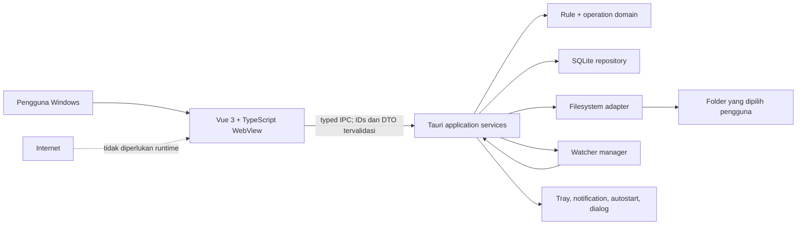
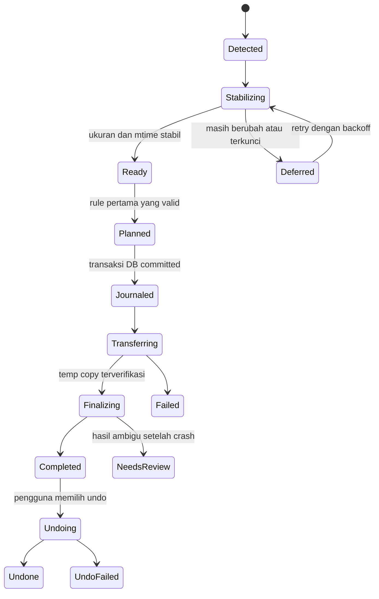

# Arsitektur Auto File Organizer v2

Status: keputusan target untuk rebuild v2. Implementasi pada branch pengembangan dapat belum memenuhi seluruh invariant sampai acceptance criteria PRD selesai.

Dokumen ini melengkapi [PRD v2](./PRD-Auto-Manage-Files-v2.md). Jika implementasi dan dokumen berbeda, keamanan data pada PRD dan invariant di bawah harus dipertahankan; perubahan desain perlu ADR baru.

## Tujuan arsitektur

- Aplikasi desktop Windows 10/11 x64 yang berfungsi tanpa koneksi jaringan saat runtime.
- Semua keputusan dan mutasi file terjadi di Rust, bukan di WebView.
- Operasi move, overwrite, dan undo dapat diaudit serta dipulihkan setelah crash.
- Domain rule dan operation engine tidak bergantung pada Tauri sehingga dapat diuji dengan temporary directory.
- Frontend hanya mengelola presentasi, input pengguna, dan DTO IPC bertipe.
- Permission Tauri, CSP, dan plugin dibuat sekecil kebutuhan nyata.

## Konteks dan trust boundary

WebView dianggap boundary yang tidak dipercaya sepenuhnya. Bug atau injeksi pada frontend tidak boleh memberi kemampuan memindahkan path arbitrer. Command seperti undo dan execute menerima operation ID atau rule ID; backend mengambil path yang sudah divalidasi dari database.

## Lapisan

### 1. Presentation

Vue 3, TypeScript strict, Pinia, dan Vue Router. Tanggung jawabnya:

- menampilkan health, rules, preview, activity, dan settings;
- validasi UX awal tanpa menggantikan validasi backend;
- menerjemahkan stable error code menjadi pesan lokal;
- memanggil satu IPC client terpusat;
- tidak membaca atau menulis filesystem secara langsung.

Komponen Vue tidak boleh berisi rule matching, collision policy, path canonicalization, atau state transition operasi.

### 2. IPC dan application services

Boundary Tauri mengubah DTO menjadi command domain. Setiap payload memiliki:

- schema yang eksplisit dan `deny_unknown_fields` bila kompatibel;
- batas panjang string dan jumlah item;
- enum untuk action/status, bukan string bebas;
- ID backend untuk rule, batch, preview, dan operation;
- error dengan `code`, `message`, `retryable`, dan `suggested_action`.

Command yang mengubah file tidak menerima pasangan source/destination bebas dari frontend. Dialog hanya memilih path; backend tetap melakukan canonicalization, cycle detection, policy check, dan persistence.

### 3. Domain/core

Core berisi rule normalization, matching, priority, destination naming, collision policy, state transition, retry decision, dan cycle detection. Core tidak mengimpor Tauri, dialog, notification, WebView, atau global application state.

I/O disediakan melalui trait/adapter agar unit dan integration test memakai fake clock serta temporary directory.

### 4. Infrastructure

- SQLite: rules, sources, batches, operations, history, recovery metadata, settings, dan migration version.
- Filesystem adapter: metadata probe, same-volume rename, cross-volume copy/verify/finalize/delete, recovery backup, dan undo.
- Watcher manager: registry source canonical, bounded queue, dedupe, stability probe, retry/backoff, reconciliation, pause/resume, dan health.
- OS adapters: tray, autostart, notification, folder dialog, dan graceful shutdown.

## Alur file

Urutan mutasi wajib:

1. Canonicalize source dan destination; tolak loop/cycle.
2. Pastikan file stabil dan rule masih aktif.
3. Hitung destination final dan collision outcome.
4. Persist operation journal sebelum mutasi.
5. Untuk same-volume, gunakan atomic rename bila tersedia.
6. Untuk cross-volume, copy ke nama temporary pada destination, flush/verify, atomic finalize, baru hapus source.
7. Untuk overwrite, pindahkan destination lama ke recovery storage sebelum finalize.
8. Commit status dan history dalam transaksi.
9. Emit event DTO terstruktur setelah persistence sukses.

Startup recovery memeriksa operation non-terminal dan menuntaskan, rollback, atau menandai `NeedsReview`. Status ambigu tidak boleh dilaporkan sebagai sukses.

## Invariant keselamatan data

- Preview tidak memodifikasi file atau database operation.
- Satu event/path menghasilkan maksimal satu operation aktif melalui idempotency key.
- Rule hanya dapat memproses file yang berada di salah satu source canonical miliknya.
- Destination di dalam recursive source ditolak.
- Source tidak dihapus sebelum destination final terverifikasi.
- Existing destination tidak dihapus tanpa recovery record.
- Auto-rename dialokasikan secara race-safe.
- Undo menggunakan operation ID dan path original absolut dari journal.
- Riwayat tidak dibentuk dengan parsing string log.
- Shutdown menghentikan penerimaan job baru lalu memberi job aktif kesempatan menyelesaikan checkpoint.

## Persistence

SQLite menggunakan foreign key, transaction, dan migration berurutan. Tabel logis minimum:

- `rules` dan `rule_sources`;
- `batches` dan `operations`;
- `operation_events` atau journal terstruktur;
- `recovery_files`;
- `settings` dan `schema_metadata`.

Semua timestamp disimpan UTC. UI melakukan pagination. Retention default history/recovery adalah 30 hari, tetapi file recovery tidak boleh dihapus saat masih direferensikan operasi yang dapat di-undo.

Database dan log berada di app data milik pengguna, bukan di folder instalasi atau repository. Migration membuat backup sebelum perubahan yang tidak trivially reversible.

## Watcher dan concurrency

Satu watcher manager hidup sepanjang proses. Perubahan rule memperbarui registry secara atomik; menyimpan settings/history tidak me-restart watcher. Queue bersifat bounded agar event storm tidak menghabiskan memori. Overflow mengubah health menjadi degraded dan memicu reconciliation scan.

Worker tidak menahan global mutex saat tidur, copy file, atau mengirim event. Cancellation/pause menghentikan job baru tetapi tidak memotong mutasi di tengah critical section.

## Security boundary Tauri

- Capability hanya berlaku untuk window `main` dan disebut eksplisit di `tauri.conf.json`.
- Izin plugin diberikan per command; hindari `core:default`, `opener:default`, dan permission default plugin yang luas.
- URL eksternal dibatasi ke repository resmi dan dibuka di browser sistem.
- Tidak ada shell plugin, generic filesystem plugin, generic SQL API, atau remote WebView content.
- CSP production hanya mengizinkan asset lokal dan IPC Tauri.
- Import dibatasi ukuran, schema version, jumlah rule/source, dan diproses dalam transaksi.
- Full path tidak dimasukkan ke notifikasi OS ketika privacy mode aktif.

Capability tidak melindungi command Rust yang salah desain. Karena itu validasi backend dan signature command berbasis ID tetap merupakan kontrol utama.

## Offline dan packaging

Runtime tidak memuat font, script, image, API, telemetry, updater, atau halaman remote. Link About bersifat user-initiated dan dibuka di browser default.

Dua installer NSIS dibangun pada tag versi:

- `standard`: kecil; memakai WebView2 yang tersedia dan dapat membutuhkan bootstrapper jika runtime hilang;
- `airgap`: menyertakan WebView2 offline installer sehingga instalasi tidak memerlukan internet dan ukuran jauh lebih besar.

Build source tetap membutuhkan dependency npm/crates kecuali dependency divendor terpisah. Offline runtime, offline installer, dan reproducible offline build adalah tiga jaminan berbeda.

## Quality gates

Pull request ke `main` wajib melewati:

- `npm ci`, `npm audit --audit-level=high`, dan pemeriksaan sinkronisasi versi/config release;
- ESLint, TypeScript strict, unit test, dan Vite production build;
- `cargo fmt --check`;
- `cargo clippy --all-targets --all-features --locked -- -D warnings`;
- `cargo test --all-features --locked`;
- Tauri release-mode smoke build pada Windows.

Tag rilis juga membangun installer standard dan airgap, menghasilkan SHA-256, dan membuat draft release. Build tetap berlabel `UNSIGNED` sampai code signing resmi dikonfigurasi.

## Batas kompatibilitas

Baseline: Windows 10 22H2/Windows 11 x64 dan NTFS. FAT/exFAT, removable drive, long path, file locked, permission denied, disk penuh, cross-volume, dan crash recovery harus diuji eksplisit. Keberhasilan build pada GitHub-hosted Windows Server bukan pengganti smoke test Windows 10 dan Windows 11.
